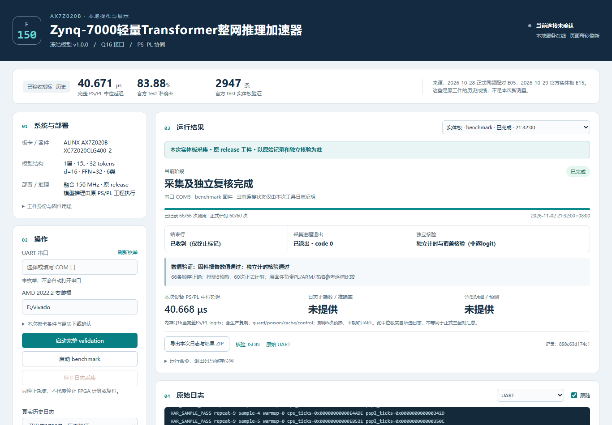

# Zynq-7000 轻量 Transformer 整网推理加速器

面向 ALINX AX7Z020B / XC7Z020CLG400-2 的定点 Transformer 加速工程。HLS 实现整网融合核，PL 运行于150MHz；裸机PS管理输入、内存一致性、调用和结果检查。附带本地中文网页，支持验证、基准测试和真实历史日志回放。

本仓库的工程主体位于 **[fusion150-final-code](fusion150-final-code/README.md)**，包括可浏览源码和原已测工件。冻结模型版本名为v1.0.0，最终硬件为融合150MHz实现。

## 模型与系统

- 输入：128个时间点 × 9个惯性通道，每4点组成patch，生成32个token。
- 网络：嵌入宽16、一层单头自注意力、前馈宽32、RMSNorm、残差、平均池化与六分类输出。
- 数值：GEMM操作数INT8、累加INT32；激活和输入输出使用含16位小数的Q16格式，Q16不表示总位宽只有16位。
- PL完成十个GEMM及非线性计算，权重和层间工作集留在片上；PS每条输入发起一次整网调用。
- 控制经AXI-Lite，数据经ACP一致性通路访问内存。驱动保留输出预填、保护区检查和超时事务drain。

## 已验收结果

|项目|留存结果|范围|
|---|---|---|
|实际PL时钟|150MHz|原部署实现|
|完整PS/PL热调用中位延迟|40.671μs|150MHz正式三配对；相对H-bank参考42.234μs降低3.70%|
|官方test准确率|83.88%|2026-10-29实体板2947条，2472条正确|
|官方test Macro-F1|83.73%|由实际板端logits重算|
|板端整数一致性|17682个logits零差异|2947条官方test，与冻结整数参考逐值比较|
|连续压力|32.61分钟、43,104,000次重复推理|开发输入重复，不是同等数量独立样本|
|供电后复验|三次真实断电后JTAG加载，每次1796条验证|不表示SD或Flash自启动|
|资源|LUT 41274、FF 44768、BRAM 98.5 tiles、DSP 216/220|原部署实现报告|

计时从内存已有Q16输入到完整PS/PL logits，包含生产驱动、必要复制、guard/poison及cache/control；排除JTAG下载、离线输入转换、网页响应与UART输出。固定6输入，排除6次预热后每轮60次正式计时。该中位数不构成所有输入的最坏延迟或持续吞吐保证。

证据入口：[结果与验收范围](docs/RESULTS.md)、[原始工程证据索引](fusion150-final-code/evidence/report/INDEX.md)。

## 仓库内容

```text
.
├── README.md                     GitHub项目首页
├── SOURCE_PACKAGE.json           原工程包及部署工件身份
├── docs/
│   ├── REPRODUCE.md              环境、校验、构建和演示
│   └── RESULTS.md                指标来源、验收及限制
└── fusion150-final-code/          与比赛最终工程逐字节一致的完整副本
    ├── hardware/                 HLS整网核、SoC Tcl和板级配置
    ├── software/                 PS驱动、五用途程序、BSP及链接配置
    ├── model/                    训练/划分/导出源码、冻结参数与模型锁
    ├── release/                  原bit、XSA、PS-init及五用途ELF
    ├── demo-ui/                  Python本地服务、网页、验收与截图
    ├── tools/                    内容校验、复建、固件构建与采集
    ├── tests/official/            冻结官方test输入、标签与预期logits
    ├── evidence/                 留存UART、资源/时序报告及复核记录
    └── THIRD_PARTY/               数据来源与第三方通知
```

关键源码：[模型](fusion150-final-code/model/har_accel/model.py)、[HLS整网实现](fusion150-final-code/hardware/hls/src/har_net.cpp)、[生产PS驱动](fusion150-final-code/software/ps/har_net_pl.c)。

## 快速开始

Windows环境，建议将仓库放在短ASCII路径，如`E:/fpga/zynq7000-transformer`。Python 3.11+；内容与留存日志校验使用标准库，工程宿主构建需要NumPy，串口采集另需pyserial。完整硬件复建需要自行安装AMD Vivado/Vitis/Vitis HLS 2022.2及Zynq ARM组件。

在仓库根目录运行：

```powershell
$pkg = (Resolve-Path './fusion150-final-code').Path
$py = 'python'  # 或替换为已有虚拟环境的python.exe完整路径
& $py -m pip install -r "$pkg/requirements.txt"
& $py -X utf8 -B "$pkg/tools/verify.py" --package $pkg
```

该校验检查内容清单、31项模型锁、构建映射、bit/XSA绑定和原官方UART的2947条/17682个logits。它只复核留存文件，无需连接板卡。

查看本地展示界面：

```powershell
& $py -X utf8 -B "$pkg/demo-ui/server.py" --data E:/fpga-demo-runs
```

浏览器打开 <http://127.0.0.1:8765>。可先使用明确标注的历史日志回放；实板操作按[演示说明](fusion150-final-code/demo-ui/README.md)准备AMD hw_server、板卡、JTAG和实际串口，并在页面确认当次条件。运行输出必须位于整个工程包外。

完整源码复建、五用途固件编译和逐条板验见[复现说明](docs/REPRODUCE.md)。

## 展示软件

下面是2026-11-02实际网页操作留下的benchmark记录，单轮40.668μs；页面顶部40.671μs是历史正式配对指标。



2026-11-03新增开发集1796条/官方test2947条选择。提交工程留存的新增official网页路径验收为离线测试和历史回放；原2026-10-29官方实体板验收保持原范围。[软件验收记录](fusion150-final-code/demo-ui/ACCEPTANCE.md)说明已覆盖和未覆盖项目。

## 工件身份与复建

原部署bit的SHA256：

```text
c5e1a3bb1d4cae7698bf39458b76aa71fa918e79f4252b3c880d478ae617bde2
```

工程内部的`MANIFEST.json`、`MANIFEST.sha256`、`provenance.json`和`candidate.json`保留原内容。外层GitHub首页与文档不属于该工程清单。请保留仓库的`.gitattributes`，避免Git换行转换或过滤器改变封存文件字节。

新复建bit作为新工件，需独立完成时序审查与板验。仓库内原工件的历史成绩不能自动转移给新bit。

## 使用边界和第三方来源

当前演示使用预置Q16输入和JTAG加载，尚未提供实时传感器采集、SD/Flash自启动、功耗/能效或持续吞吐实测。原时序和Warning处置见证据；DSP占用216/220，时序余量较薄，详见[结果说明](docs/RESULTS.md)。

数据来源为UCI HAR，论文及随数据保留的使用条件见[第三方说明](fusion150-final-code/THIRD_PARTY.md)。AMD/Xilinx BSP等代码保留原通知，开发工具由使用者自行安装。项目自有代码尚未附加MIT等开源许可，公开可见不代表授予任意再分发或商业使用许可。
